<p align="center">
  
</p>

<p align="center">
  <a href="https://t.me/+t1qJ_32133FjNjNk"></a>
  <a href="https://github.com/devharborhq/telegram-guard"></a>
  <a href="https://github.com/devharborhq/telegram-guard/issues?q=is%3Aopen+label%3A%22good+first+issue%22"></a>
</p>

```console
$ cat /etc/motd

  devs from different countries, one Telegram group.
  we break things, fix them, and ship the tools in the open.
  any level welcome. curiosity > experience.
```

### `~/projects`

```console
$ tree -L 1 ./projects
.
├── telegram-guard   # the bot that guards our own group: join checks, raid & flood
│                    # protection, link + file scanning (VirusTotal). python.
└── ...              # next one is up to whoever shows up
```

**[telegram-guard](https://github.com/devharborhq/telegram-guard)** runs 24/7 in our group and blocks spam bots, scam links and malware files before members ever see them. Want to poke at it? Grab a [`good first issue`](https://github.com/devharborhq/telegram-guard/issues?q=is%3Aopen+label%3A%22good+first+issue%22), or try to get something past it and [tell us how](https://github.com/devharborhq/telegram-guard/security) 🙂

### `~/stack`

<p>
  
  
  
  
  
  
</p>

### `./join`

```console
$ ./join --group devharbor
[*] resolving t.me/devharborhq ...
[+] ask anything · show what you're building · find people to build with
[+] done. say hi 👋
```

<p align="center"><sub>⚓ built in the open by DevHarbor · <a href="https://t.me/+t1qJ_32133FjNjNk">t.me/devharborhq</a></sub></p>
